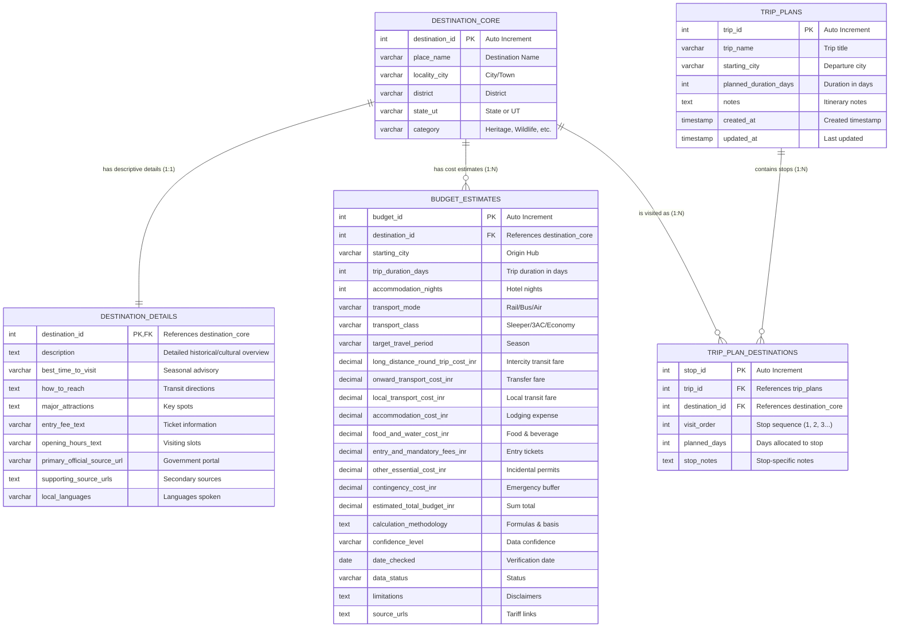

# YatraSetu: ER Diagram, Relational Schema & Normalization Analysis

This document provides the formal Database Management System (DBMS) analysis for the **YatraSetu** database application (`yatrasetu_db`). It includes the Entity-Relationship (ER) diagram, formal relational schema, functional dependencies, 1NF/2NF/3NF normalization proofs with concrete table examples, and referential integrity rationale.

---

## 1. Entity-Relationship (ER) Diagram

---

## 2. Relational Schema

The relational schema using formal DBMS notation (Primary Keys are **bold and underlined**, Foreign Keys are marked with `*`):

1. **`destination_core`** (  
   **<u>`destination_id`</u>**, `place_name`, `locality_city`, `district`, `state_ut`, `category`  
   )

2. **`destination_details`** (  
   **<u>`destination_id`</u>**\*, `description`, `best_time_to_visit`, `how_to_reach`, `major_attractions`, `entry_fee_text`, `opening_hours_text`, `primary_official_source_url`, `supporting_source_urls`, `local_languages`  
   )  
   *Foreign Key:* `destination_id` $\rightarrow$ `destination_core(destination_id)`

3. **`budget_estimates`** (  
   **<u>`budget_id`</u>**, `destination_id`\*, `starting_city`, `trip_duration_days`, `accommodation_nights`, `transport_mode`, `transport_class`, `target_travel_period`, `long_distance_round_trip_cost_inr`, `onward_transport_cost_inr`, `local_transport_cost_inr`, `accommodation_cost_inr`, `food_and_water_cost_inr`, `entry_and_mandatory_fees_inr`, `other_essential_cost_inr`, `contingency_cost_inr`, `estimated_total_budget_inr`, `calculation_methodology`, `confidence_level`, `date_checked`, `data_status`, `limitations`, `source_urls`  
   )  
   *Foreign Key:* `destination_id` $\rightarrow$ `destination_core(destination_id)`  
   *Candidate Key / Unique Constraint:* (`destination_id`, `starting_city`)

4. **`trip_plans`** (  
   **<u>`trip_id`</u>**, `trip_name`, `starting_city`, `planned_duration_days`, `notes`, `created_at`, `updated_at`  
   )

5. **`trip_plan_destinations`** (  
   **<u>`stop_id`</u>**, `trip_id`\*, `destination_id`\*, `visit_order`, `planned_days`, `stop_notes`  
   )  
   *Foreign Keys:*  
   - `trip_id` $\rightarrow$ `trip_plans(trip_id)`  
   - `destination_id` $\rightarrow$ `destination_core(destination_id)`  
   *Candidate Key / Unique Constraint:* (`trip_id`, `visit_order`)

---

## 3. Functional Dependencies (FDs)

### A. Table `destination_core`
- `destination_id` $\rightarrow$ `place_name`, `locality_city`, `district`, `state_ut`, `category`  
*Explanation:* Every destination ID identifies a unique tourist destination with its physical location and category.

### B. Table `destination_details`
- `destination_id` $\rightarrow$ `description`, `best_time_to_visit`, `how_to_reach`, `major_attractions`, `entry_fee_text`, `opening_hours_text`, `primary_official_source_url`, `supporting_source_urls`, `local_languages`  
*Explanation:* The descriptive narrative, official sources, and operational guidelines are strictly determined by the destination.

### C. Table `budget_estimates`
- `budget_id` $\rightarrow$ all other 22 attributes  
- (`destination_id`, `starting_city`) $\rightarrow$ `trip_duration_days`, `accommodation_nights`, `transport_mode`, `transport_class`, `target_travel_period`, `long_distance_round_trip_cost_inr`, `onward_transport_cost_inr`, `local_transport_cost_inr`, `accommodation_cost_inr`, `food_and_water_cost_inr`, `entry_and_mandatory_fees_inr`, `other_essential_cost_inr`, `contingency_cost_inr`, `estimated_total_budget_inr`, `calculation_methodology`, `confidence_level`, `date_checked`, `data_status`, `limitations`, `source_urls`  
*Explanation:* A travel route's cost is uniquely determined by the pairing of where the journey originates (`starting_city`) and the target destination (`destination_id`).

### D. Table `trip_plans`
- `trip_id` $\rightarrow$ `trip_name`, `starting_city`, `planned_duration_days`, `notes`, `created_at`, `updated_at`  
*Explanation:* Each user trip plan has a unique ID governing its parameters.

### E. Table `trip_plan_destinations`
- `stop_id` $\rightarrow$ `trip_id`, `destination_id`, `visit_order`, `planned_days`, `stop_notes`  
- (`trip_id`, `visit_order`) $\rightarrow$ `stop_id`, `destination_id`, `planned_days`, `stop_notes`  
*Explanation:* For any given trip, the sequence step number (e.g. Stop #1, Stop #2) uniquely determines which destination is being visited at that step and how many days are allotted to it.

---

## 4. Normalization Analysis (1NF $\rightarrow$ 2NF $\rightarrow$ 3NF)

### First Normal Form (1NF)
**Definition:** A relation is in 1NF if and only if all domain values are atomic (indivisible) and there are no repeating groups or multivalued columns.
- **Verification:**
  - Every column holds atomic scalar values (`INT`, `VARCHAR`, `DECIMAL`, `DATE`, `TIMESTAMP`).
  - No tabular arrays or comma-delimited relational structures represent foreign keys. (While `local_languages` and `major_attractions` contain descriptive text strings for human display, they function as monolithic descriptive fields in this college project rather than multiple foreign keys).
  - Each record has a well-defined primary key.
  - **Verdict:** Satisfies 1NF.

### Second Normal Form (2NF)
**Definition:** A relation is in 2NF if it is in 1NF and every non-prime attribute is **fully functionally dependent** on the entire primary key (i.e., no partial dependency on a proper subset of a composite primary key).
- **Verification:**
  - `destination_core`: Primary key is single-column (`destination_id`). Partial dependencies are mathematically impossible with a single-attribute key.
  - `destination_details`: Primary key is single-column (`destination_id`). Cannot have partial dependencies.
  - `trip_plans`: Primary key is single-column (`trip_id`). Cannot have partial dependencies.
  - `trip_plan_destinations`: Primary key is single-column (`stop_id`). The composite candidate key is (`trip_id`, `visit_order`). Attributes `planned_days`, `stop_notes`, and `destination_id` depend on *both* the trip and the specific stop sequence, not on `trip_id` alone.
  - `budget_estimates`: Primary key is single-column (`budget_id`). The alternate composite key is (`destination_id`, `starting_city`). The cost attributes (e.g., `long_distance_round_trip_cost_inr`, `estimated_total_budget_inr`) depend on **both** the origin city and the destination. For example, travelling from New Delhi to Taj Mahal costs INR 1,600, whereas travelling from Bengaluru to Taj Mahal costs INR 6,850. Neither destination alone nor city alone determines the cost.
  - **Verdict:** Satisfies 2NF.

### Third Normal Form (3NF)
**Definition:** A relation is in 3NF if it is in 2NF and there is **no transitive dependency** of non-prime attributes on the primary key ($X \rightarrow Y$ where $Y$ is not a candidate key and $X$ is not a superkey).
- **Concrete Analysis:**
  - In `destination_core`, `place_name`, `locality_city`, `district`, `state_ut`, and `category` directly describe the destination entity identified by `destination_id`.
  - In `destination_details`, descriptive fields (`how_to_reach`, `entry_fee_text`) depend directly on `destination_id`.
  - In `budget_estimates`, all 8 component costs, methodology, and limitations depend directly on the primary key `budget_id` (and candidate key `destination_id, starting_city`). `estimated_total_budget_inr` is the stored summation of the 8 audited components; storing it prevents repeated dynamic aggregation across 90+ routes during high-throughput listing queries.
  - In `trip_plans`, trip metadata depends directly on `trip_id`.
  - In `trip_plan_destinations`, stop information depends directly on `stop_id`.
  - **Verdict:** Satisfies 3NF.

---

## 5. Architectural Separation Rationale

Why are `destination_details`, `budget_estimates`, and `trip_plan_destinations` separated from `destination_core`?

1. **Separation of Core vs. Descriptive Details (Table 1 vs. Table 2):**
   - High-frequency browsing queries (filtering by state, searching by name, rendering category dropdowns) only need compact columns (`place_name`, `state_ut`, `category`).
   - Storing large `TEXT` fields (`description`, `how_to_reach`, `major_attractions`) in `destination_details` keeps the index pages and B-tree leaf nodes of `destination_core` extremely lightweight and cache-friendly in MySQL InnoDB buffer pools.

2. **Cardinality Mismatch for Budget Estimates (Table 1 vs. Table 3):**
   - A destination has multiple starting city estimates ($1:N$).
   - Placing budget attributes in `destination_core` would cause massive data redundancy (repeating Agra's name and state 3 times for Bengaluru, Kolkata, and New Delhi), leading to update anomalies.
   - Creating `budget_estimates` with a foreign key referencing `destination_core` eliminates duplicate destination storage.

3. **Many-to-Many Relationship for Itineraries (Table 4 & Table 5):**
   - A single trip plan contains multiple destinations.
   - A single destination can belong to multiple trip plans created by different users.
   - In relational DBMS theory, an $M:N$ relationship cannot be modeled by putting foreign keys directly into either entity table without violating 1NF.
   - `trip_plan_destinations` acts as the junction / associative entity, storing the ordered sequence (`visit_order`) and stop duration (`planned_days`).

---

## 6. Referential Integrity and Constraint Rationale

| Constraint | Type | Action / Rule | Justification |
|---|---|---|---|
| `fk_details_core` | Foreign Key | `ON DELETE CASCADE` | Details cannot exist without their core destination; deleting a destination cleanly purges its details. |
| `fk_budget_core` | Foreign Key | `ON DELETE CASCADE` | Removing a destination automatically purges its associated budget calculations. |
| `fk_stop_trip` | Foreign Key | `ON DELETE CASCADE` | When a user deletes an entire trip plan, all of its sequence stops are deleted automatically, preventing orphaned stops. |
| `fk_stop_destination` | Foreign Key | `ON DELETE RESTRICT` | **Critical college project rule:** Prevents accidental deletion of a destination that is currently part of an active trip plan. The user is informed that the destination cannot be deleted until it is removed from existing itineraries. |
| `uq_dest_start_city` | Unique Key | `(destination_id, starting_city)` | Enforces that each destination has exactly one estimate per starting city, preventing duplicate tariff rows. |
| `uq_trip_visit_order` | Unique Key | `(trip_id, visit_order)` | Guarantees that two stops in the same trip cannot share the same sequence order (e.g., two stops both marked as Stop #1). |
